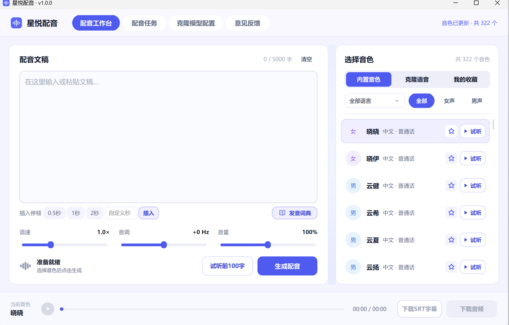
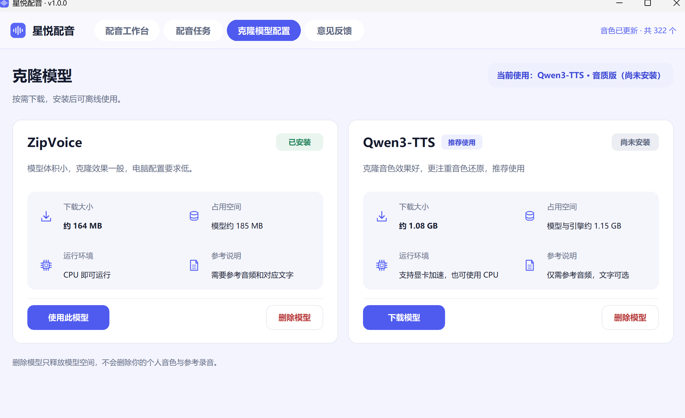
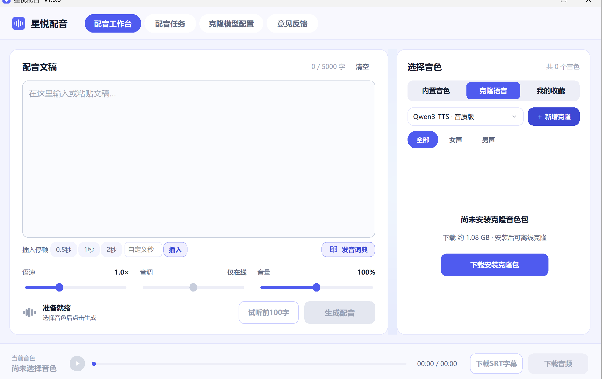

# StraVoice · 星悦配音

**把文稿变成可剪辑的配音。先试听定音色，逐段调整口播节奏，再导出 MP3 和 SRT。**

星悦配音是一款面向 Windows 的桌面配音工具，适合短视频解说、课程旁白、播客片段和多语言内容。你可以从数百个在线音色中挑选，也可以导入自己的参考录音，在本机克隆声音。

| Windows 10 / 11 64 位 | 如何使用 |
| --- | --- |
| [下载安装版](https://github.com/vesper-tools/StraVoice/releases/download/v1.0.1/StraVoice-1.0.1-windows-x64-setup.exe) | 运行安装程序，按向导完成安装。 |
| [下载便携版](https://github.com/vesper-tools/StraVoice/releases/download/v1.0.1/StraVoice-1.0.1-windows-x64-portable.zip) | 完整解压 ZIP，运行 `星悦配音.exe`。首次运行可先安装 `prerequisites` 中的 VC++ x64 运行库。 |



## 从文稿到成片

- **多语言音色，选中就能试听。** 截图中的音色目录包含 322 个声音，覆盖普通话、粤语及多种语言。支持按语言和性别筛选、收藏常用音色，以及用当前文稿的前 100 字试听。音色数量随服务更新。
- **按口播节奏控制停顿。** 支持调整语速、音量，在线音色还可调整音调。可插入 0.5 秒、1 秒、2 秒或自定义停顿，字幕时间会随音频顺延。单次文稿最多 5,000 字符。
- **改一句，只重配这一段。** 在「配音任务」中编辑、试听或重新生成指定段落。继续生成时会复用有效的已完成片段，再合并整条配音。任务保留在本次启动期间。
- **专业名词按你指定的方式读。** 在发音词典中写入 `AI = 人工智能`，配音时会按右侧读法朗读，屏幕文稿和导出的字幕仍显示 `AI`。旧任务也可应用当前词典。
- **导出 MP3 与 SRT。** 底部播放器支持暂停、续播和拖动定位。音频可直接导入剪辑软件，SRT 可作为独立字幕轨。克隆语音的字幕按合成分段对齐。

## 用自己的声音做旁白

进入「克隆模型配置」按需安装模型，再在工作台的「克隆语音」中添加音色。参考录音建议使用 3–10 秒清晰、单人说话的片段。请使用你本人或已获授权的录音。模型安装完成后，克隆合成在本机运行。在线音色合成需要联网。

| 模型 | 适合场景 | 参考材料 | 下载大小 |
| --- | --- | --- | --- |
| **ZipVoice** | 希望用 CPU 运行，或优先考虑模型体积 | 参考录音及对应文字 | 约 164 MB |
| **Qwen3-TTS** | 更在意音色还原，希望使用显卡加速 | 参考录音即可 | 约 1.08 GB |



<details>
<summary>查看克隆音色与发音词典界面</summary>




</details>

## 快速上手

1. 粘贴文稿，选择音色。视频开头可以先用「试听前100字」找准声线和语速。
2. 给段落转折加停顿。遇到人名、品牌、缩写读错时，用发音词典指定读法。
3. 点击「生成配音」。只需修改某句话时，前往「配音任务」重生成该段。
4. 在底部试听整条配音，导出 MP3 和 SRT。

在线配音通过 Edge TTS 使用微软语音服务，合成文稿会发送至该服务。克隆模型按需下载。模型、收藏、发音词典和个人音色保存在 `%LOCALAPPDATA%\FreeVoice`。

## 从源码运行

Windows 下使用 Python 3.12（含 Tcl/Tk）。

```powershell
git clone https://github.com/vesper-tools/StraVoice.git
cd StraVoice
py -3.12 -m venv .venv
.\.venv\Scripts\python.exe -m pip install -r requirements.txt
.\.venv\Scripts\python.exe app.py
```

运行测试使用 `.\.venv\Scripts\python.exe -m unittest discover -q`。安装包构建使用 PyInstaller 与 Inno Setup 6，构建入口为 `packaging/build_release.ps1`。构建前需准备 Qwen worker、外部语音处理资源和已校验的 VC++ 运行库。Qwen worker 的构建脚本为 `native/build_worker.py`，依赖 Visual Studio C++ Build Tools 和已下载的 Qwen 运行库。

项目原创源码采用 [MIT 许可证](LICENSE)。语音引擎、模型和依赖各自遵循上游许可，见 [第三方组件说明](THIRD_PARTY/README.txt)。

欢迎在 [Issues](https://github.com/vesper-tools/StraVoice/issues) 提交功能建议或反馈问题。
